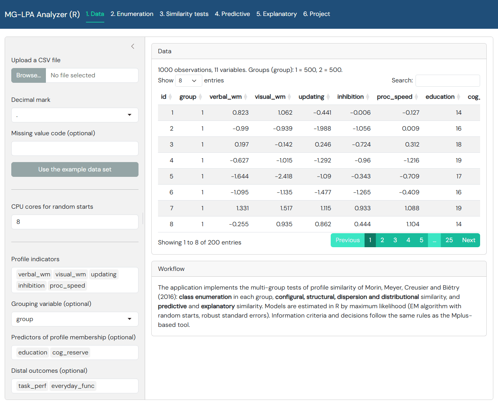
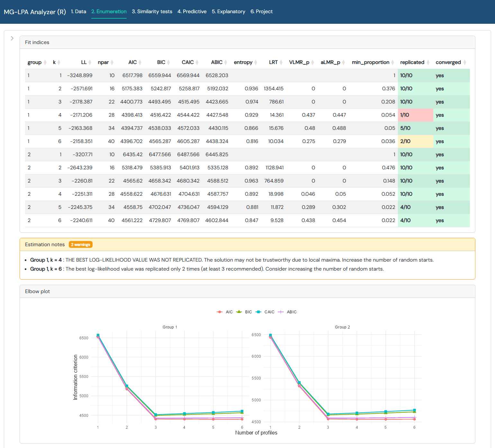
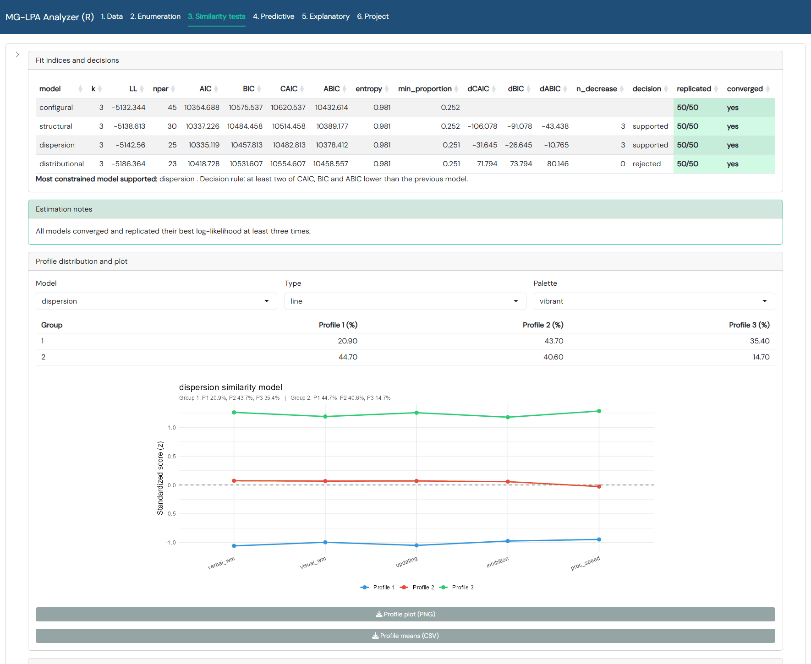
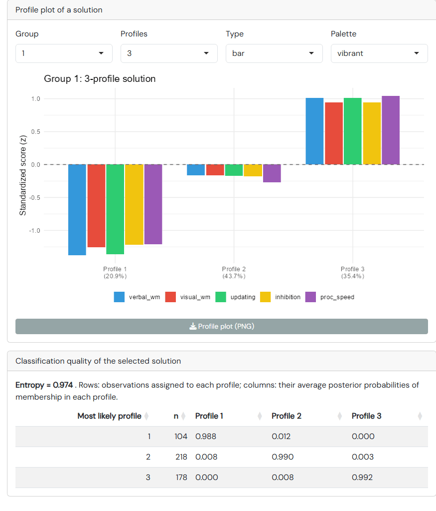
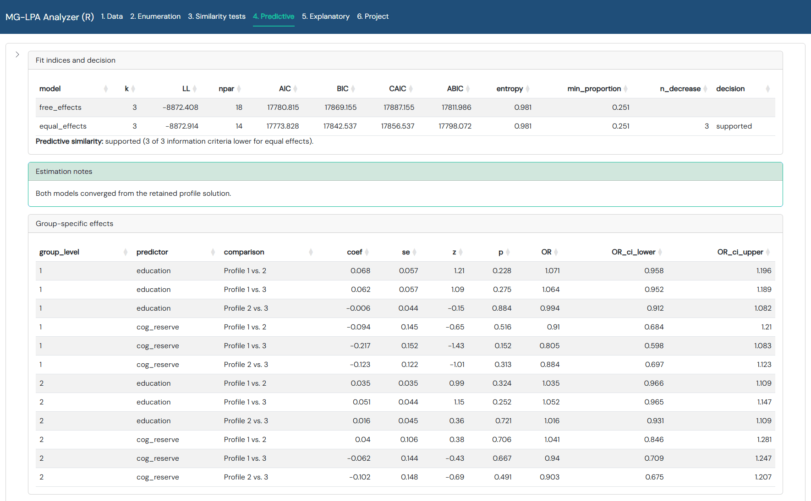
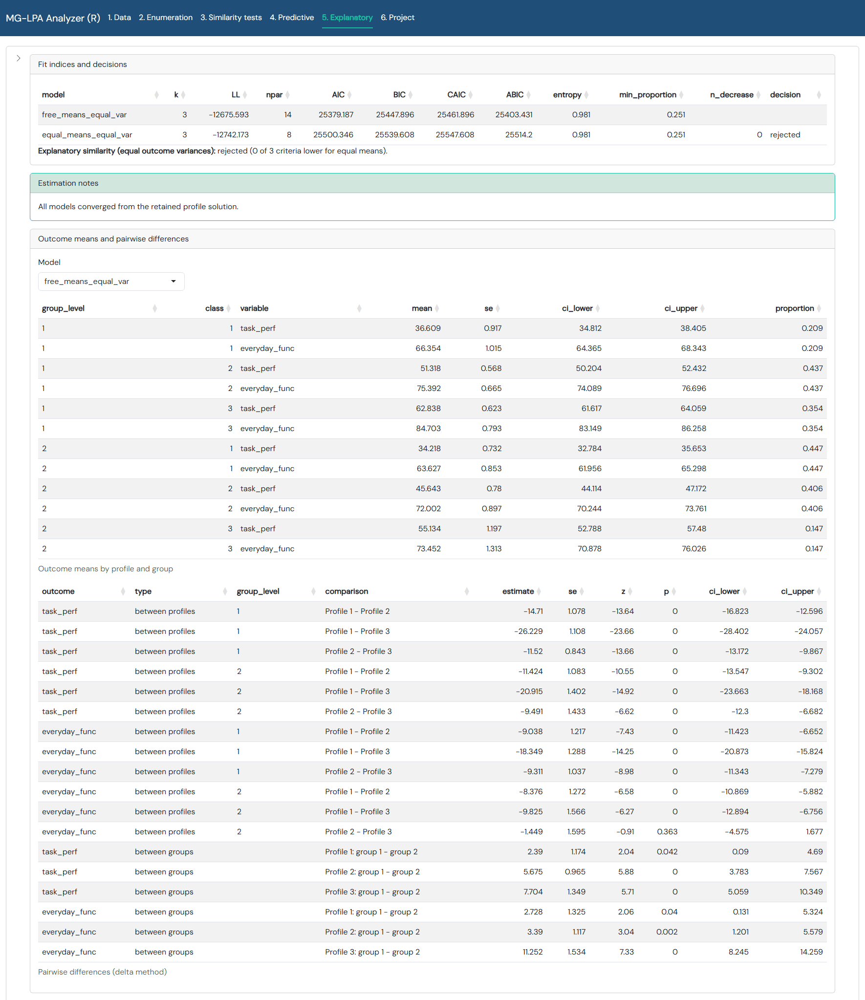

# mglpa

**Multi-group latent profile analysis and tests of profile similarity in R.**

`mglpa` estimates latent profile analysis (LPA) models with continuous
indicators across known groups and implements the six-step sequence of
multi-group tests of profile similarity proposed by Morin, Meyer, Creusier and
Biétry (2016): class enumeration, configural, structural, dispersion and
distributional similarity, and predictive and explanatory similarity. It is
the R counterpart of the browser-based
[MG-LPA Analyzer](https://cahitgs.github.io/mglpa-analyzer/), with one
essential difference: **all models are estimated in R**, so Mplus is not
needed.

## What it does

- Diagonal Gaussian mixture models (LPA) with class-invariant or
  class-varying variances, estimated by maximum likelihood with an EM
  algorithm, Mplus-style two-stage random starts and FIML for missing
  indicator values.
- Cross-group equality constraints on means, variances and proportions
  (configural → structural → dispersion → distributional).
- Multinomial logistic regression of profile membership on predictors with
  group-specific or equal effects (predictive similarity), and distal outcomes
  with profile-specific means (explanatory similarity), with the profile
  solution held fixed at an earlier solution as in Morin's approach.
- Robust (sandwich, `MLR`-type) or maximum-likelihood standard errors,
  delta-method contrasts (all pairwise profile comparisons, between-group
  differences), odds ratios and confidence intervals.
- AIC, BIC, CAIC, ABIC, entropy, profile proportions by group, the
  two-out-of-three decision rule, the Vuong-Lo-Mendell-Rubin and adjusted
  Lo-Mendell-Rubin likelihood ratio tests (`vlmr_test()`, the analogue of
  Mplus `TECH11`), a parametric bootstrap likelihood ratio test (`blrt()`,
  `TECH14`), classification-quality tables, elbow plots, profile plots (bar,
  line, radar; nine palettes), APA-style tables and Word-compatible exports.
- A Shiny application (`mglpa_app()`) with the same workflow as the web tool,
  for analyses without writing R code ([see below](#the-shiny-application)).

The log-likelihoods, free-parameter counts, information criteria, entropy,
standard errors and the `TECH11` tests (statistic, mean, standard deviation
and p-values of the VLMR and aLMR tests) reproduce the Mplus values of the
example project of the MG-LPA Analyzer to three decimals, as well as
additional Mplus 9 reference runs with class-varying variances, three known
groups and missing indicator values (see `tests/testthat`).

## Installation

1. Install [R](https://cran.r-project.org/) (version 4.1 or later).
   [RStudio](https://posit.co/download/rstudio-desktop/) is convenient but not
   required.
2. Install a C++ compiler, which R needs to build the package from its source
   code: [Rtools](https://cran.r-project.org/bin/windows/Rtools/) on Windows
   (the version that matches your R version) or the Xcode command-line tools
   on macOS (run `xcode-select --install` in the Terminal). Linux systems
   usually have a compiler already (`r-base-dev` on Debian and Ubuntu).
3. In R, install the package from GitHub together with the packages used by
   the Shiny application:

   ```r
   install.packages(c("remotes", "shiny", "bslib", "DT"))
   remotes::install_github("cahitgs/mglpa")
   ```

A local copy of the source folder can be installed with
`remotes::install_local("path/to/mglpa")`.

## The Shiny application

The package comes with a point-and-click application that covers the whole
workflow, so no R code has to be written. It runs on your own computer: the
data stay there and every model is estimated by R.

```r
library(mglpa)
mglpa_app()
```

The application opens in the web browser (or in the RStudio window). Click
**Use the example data set** on the first tab to try it with the data of the
examples below, or upload your own CSV file. To stop the application, close
the browser tab and press `Esc` in the R console (`Ctrl + C` in a terminal).



The tabs follow the steps of the analysis. The settings of each step (number
of profiles, variance specification, random starts, seed) are in the sidebar
on the left; it is collapsed in the screenshots below to leave room for the
tables.

| Tab | What it does |
|---|---|
| **1. Data** | Upload a CSV file or load the example data; choose the profile indicators, the grouping variable, the predictors and the distal outcomes, and the number of CPU cores used for the random starts. |
| **2. Enumeration** | Solutions with 1 to *k* profiles in each group: log-likelihood, information criteria, entropy, VLMR and aLMR tests, the bootstrap likelihood ratio test on request, elbow plot, and the profile plot and classification quality of any solution. |
| **3. Similarity tests** | Configural, structural, dispersion and distributional similarity with the decision for each step, profile proportions by group and profile plots of every model. |
| **4. Predictive** | Regression of profile membership on the predictors with effects free or equal across groups; coefficients, odds ratios and confidence intervals for all pairs of profiles. |
| **5. Explanatory** | Outcome means by profile and group, the test of their equality across groups, and pairwise differences between profiles and between groups. |
| **6. Project** | Save the whole analysis to a file and load it again; export all tables to one Word file. |

Next to every model the application shows whether the estimation converged
and how often the best log-likelihood was replicated (green, yellow or red),
with Mplus-style warnings in the notes below the table. In the example below,
run with the default number of random starts, two solutions did not replicate
their best log-likelihood often enough and are flagged; more random starts
remove such warnings. Tables can be downloaded as CSV files or as
Word-compatible APA tables, and plots as PNG files.





<details>
<summary>More screenshots: profile plot and classification quality, predictive similarity, explanatory similarity</summary>







</details>

## Quick start

```r
library(mglpa)
data(mglpa_wm)   # simulated working-memory data, two age groups
ind <- c("verbal_wm", "visual_wm", "updating", "inhibition", "proc_speed")

# Step 0: class enumeration in each group
enum <- enumerate_profiles(mglpa_wm, ind, group = "group", k = 1:6,
                           starts = c(200, 20), seed = 1)
enum                                                  # with VLMR / aLMR p-values (TECH11)
enum <- enumeration_blrt(enum, B = 100, cores = 4)    # bootstrap LRT (TECH14)
elbow_plot(enum)
profile_plot(enum$fits[["1"]][["3"]])
classification_quality(enum$fits[["1"]][["3"]])

# Steps 1-4: configural, structural, dispersion, distributional similarity
sim <- similarity_tests(mglpa_wm, ind, group = "group", k = 3,
                        starts = c(200, 20), seed = 2)
sim
profile_plot(sim$fits$dispersion, type = "line")

# Step 5: predictive similarity
pred <- predictive_similarity(sim, predictors = c("education", "cog_reserve"))
pred

# Step 6: explanatory similarity
expl <- explanatory_similarity(sim, outcomes = c("task_perf", "everyday_func"))
expl

# APA-style tables
apa_table(sim)
write_table_doc(apa_table(sim), "similarity.doc",
                title = "Table 2. Fit indices of the similarity tests")

# Graphical interface
mglpa_app()
```

Any single model can also be specified and estimated directly:

```r
m <- mglpa_model(3, ind, group = "group", equal_means = TRUE, equal_variances = TRUE)
fit <- fit_lpa(mglpa_wm, m, starts = c(200, 20), seed = 3)
summary(fit)
parameters(fit)
posterior_probabilities(fit)
```

The vignette (`vignette("mglpa")`) walks through the whole sequence on the
example data and lists the conventions shared with Mplus.

## Random starts and speed

Like Mplus, `starts = c(n_initial, n_final)` runs `n_initial` random starts
for `stiterations` EM iterations and iterates the best `n_final` to
convergence. The number of final-stage optimisations that replicate the best
log-likelihood is reported for every model. Solutions with many profiles or
very small profiles may need several thousand starts to replicate the global
maximum, exactly as in Mplus.

The EM iterations run in compiled C++ code (Rcpp) for all enumeration and
similarity models; a pure-R implementation of the same algorithm is kept as a
reference (`engine = "r"`) and is used automatically for models with
predictors of profile membership or fixed membership logits. On the example
data (N = 500, 8 profiles) 10,000 initial and
500 final random starts take about 100 seconds on one core; `cores = n`
distributes the random starts over `n` CPU cores (installed package required).

## Estimation warnings

Like Mplus, every fit reports whether the EM algorithm converged and how
often the best log-likelihood was replicated. A solution that does not meet
the convergence criterion first receives four times `maxiter` additional
iterations; if it still does not converge, or if the best log-likelihood is
not replicated (or replicated fewer than three times), an R warning is
raised and the message is stored in `fit$warnings`, shown by `print()`, in
the `notes` column of the result tables and in the Shiny application.
Predictive and explanatory models are estimated from the retained profile
solution, as with `STARTS = 0` in Mplus, so only their convergence is
reported. Relabelling the profiles (`reorder_profiles()`, used by the
enumeration and similarity steps) keeps the random-start record and the
warnings of the original estimation. The bootstrap likelihood ratio test
records, for every draw, whether both models converged and how often the
k-profile model replicated its best log-likelihood; as in Mplus, a warning is
given when draws below the observed statistic may be local maxima, together
with the largest p-value they could produce, and non-converged draws are
always reported (with the smallest p-value compatible with them).

## Reference

Morin, A. J. S., Meyer, J. P., Creusier, J., & Biétry, F. (2016).
Multiple-group analysis of similarity in latent profile solutions.
*Organizational Research Methods, 19*(2), 231–254.
https://doi.org/10.1177/1094428115621148
